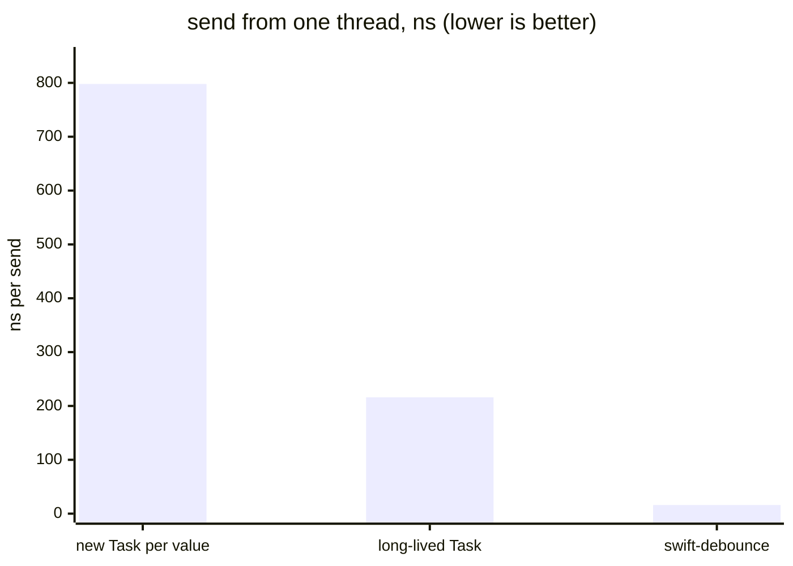
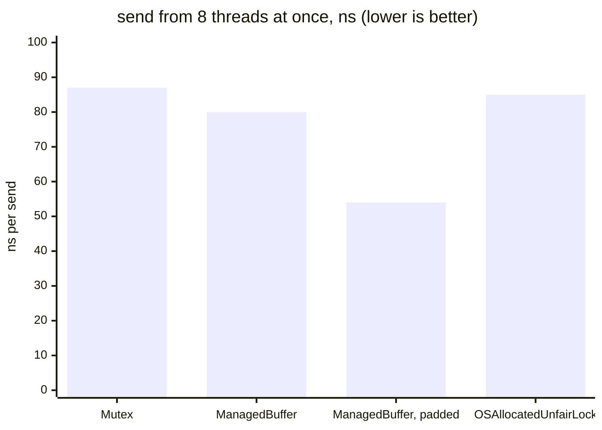

# Benchmarks

These benchmarks explain why `swift-debounce` is built the way it is. Each section answers one design question with numbers you can reproduce.

This directory is a separate Swift package. Apps that depend on `swift-debounce` never resolve or build it.

All numbers below come from one run on a MacBook Pro with an M1 Max (10 cores), macOS 26.7.1, Swift 6.4, release build, on 2026-10-13. Raw output lives in [`results/2026-10-13`](results/2026-10-13). Expect your absolute numbers to differ; the ratios are what matter.

## Summary

| | new `Task` per value | long-lived `Task` | swift-debounce |
|---|---:|---:|---:|
| `send` from 1 thread, 100k values | 798 ns | 216 ns | **16 ns** |
| `send` from 8 threads at once | 1,634 ns | 393 ns | **60 ns** |
| CPU for 8 threads × 25k values | 2,237 ms | 516 ms | **89 ms** |
| context switches, same run | 59,391 | 8,752 | **134** |
| delay after the quiet period, 1 value | 1.0 ms | 1.0 ms | 1.4 ms |



What the three columns are:

- **New `Task` per value** cancels the previous task and starts a new one that sleeps, on every `send`. It's the version most apps write first.
- **Long-lived `Task`** keeps one task for a whole burst and a state machine behind an `NSRecursiveLock`. It's the usual way to improve on the first version.
- **swift-debounce** is this package's `Debouncer`.

## Running them

```sh
./run.sh                                   # everything, about 15 minutes; writes results/<date>
swift run -c release Scenarios             # one benchmark
swift run -c release Scenarios latency     # only the timing scenarios
```

To see where time goes, spin `send` in a loop and sample it:

```sh
swift build -c release
.build/release/Locks profile 10 package &  # or: profile 10 (the long-lived Task version)
sample $! 5
```

| Executable | Question it answers |
|---|---|
| `Scenarios` | How do the three versions compare in bursts, under contention, while typing, and with 10,000 instances? |
| `Locks` | What makes `send` expensive? Which lock is best? |
| `Storage` | Where should the lock and the state live in memory? |
| `Latency` | How late does the action run after the quiet period? |
| `Throttling` | What does `Throttler` cost, and does it keep its pace? |

## 1. One task per burst, or a task per value?

Keeping one task per burst already removes most of the cost. A new task per value pays for creating, cancelling, and waking a task on every `send`. With 100,000 values in a burst, that's 100,000 tasks and 281 ms of CPU against 22 ms for the long-lived-task version and 1.7 ms for this package ([`scenarios.md`](results/2026-10-13/scenarios.md), section 1).

Under contention, 8 threads sending 25,000 values each into one debouncer:

| | new `Task` per value | long-lived `Task` | swift-debounce |
|---|---:|---:|---:|
| wall time per `send` | 1,634 ns | 393 ns | 60 ns |
| total CPU | 2,237 ms | 516 ms | 89 ms |
| context switches | 59,391 | 8,752 | 134 |

With 10,000 debouncers receiving 10 values each, a task per value grew the memory footprint by 1.7 MB during the burst; the other two didn't grow it at all.

For a person typing, about one value every 5 ms, the differences shrink: about 11 ms of CPU per second of typing for a task per value, and under 2 ms for the other two. The package matters when values arrive often, from many threads, or into many instances.

## 2. Why did the long-lived-task version's `send` cost 190 ns?

A profile (`Locks profile`) of that version's `send` included runtime metadata lookups and clock calls:

- **Unspecialized generic code.** In the inspected Swift 6.4 build, the benchmark called generic `emit` methods for both implementations, despite the CMO flag. Replacing `SafeStorage`'s `NSRecursiveLock` wrapper with `os_unfair_lock` enabled an `Int` specialization while keeping `Instant`.
- **The deadline's layout.** `ContinuousClock.Instant` comes from the `_Concurrency` library, which is built with library evolution, and is not `@frozen`. Its layout stays opaque to client code, including code specialized for `Int`.
- **Reading the clock.** `ContinuousClock.now` takes 29 ns. `mach_continuous_time()`, the counter behind it, takes 5 ns ([`locks.md`](results/2026-10-13/locks.md), section 1).

The package stores deadlines as `UInt64` ticks of `mach_continuous_time`. The lock variants in section 4 of [`locks.md`](results/2026-10-13/locks.md) keep the long-lived-task algorithm and `ContinuousClock.Instant`. Their fastest plain-lock variant took about 94 ns per `send`, against 188 ns for the original implementation and 14 ns for the package. That comparison includes differences in specialization as well as locking, so it does not isolate the lock's cost.

**Specialization.** The compiler needs access to a generic function's body to specialize it for the caller's value type. `@inlinable` makes that body available to importing modules; CMO can also expose it. While prototyping, the same `send` cost about 110 ns without `@inlinable` and 12-13 ns with it (or with `-cross-module-optimization`). The package marks `send` and its input-path helpers `@inlinable` so the compiler can specialize them for your value type.

`Scenarios` uses concrete types to avoid existential dispatch in the measured calls. Concrete dispatch does not guarantee specialization: the two benchmark implementations still called generic `emit` methods in the inspected build.

## 3. Which lock?

Uncontended, every real lock costs 8-9 ns, except `NSRecursiveLock` at 17 ns. A debouncer doesn't need recursion: no code path takes the lock twice.

| lock (`withLock { counter += 1 }`) | 1 thread | 8 threads |
|---|---:|---:|
| `NSRecursiveLock` | 17.0 ns | 37.0 ns |
| `NSLock` | 9.1 ns | 20.7 ns |
| `pthread_mutex_t` | 8.9 ns | 20.7 ns |
| `os_unfair_lock` | 8.2 ns | 38.4 ns |
| `OSAllocatedUnfairLock` | 8.1 ns | 27.7 ns |
| `Synchronization.Mutex` | 7.9 ns | 27.9 ns |
| `DispatchSemaphore` | 9.6 ns | 1,298 ns |
| `DispatchQueue.sync` | 257 ns | 2,143 ns |

The raw-lock numbers under contention are noisy from run to run. Inside a full debouncer (the long-lived-task algorithm from section 2), the `os_unfair_lock` family used less CPU and caused 10 times fewer context switches than `NSLock` or `pthread_mutex_t` ([`locks.md`](results/2026-10-13/locks.md), section 4). Semaphores and serial queues park threads and wake them up again, about 800,000 context switches for 800,000 sends.

**Not an actor.** With an actor, `send` becomes `async`. Called from the main actor it costs about 6 µs, because every call hops to the actor and back. Code that isn't async would have to wrap each call in a `Task`, which brings back the task-per-value cost.

**One lock for every OS version.** `Synchronization.Mutex` compiles down to `os_unfair_lock_lock` and `os_unfair_lock_unlock` on Apple platforms, and `OSAllocatedUnfairLock` is an `os_unfair_lock` in a heap allocation. They're the same lock. The package puts an `os_unfair_lock` and the state in one `ManagedBuffer` allocation, which works from iOS 13 and measures the same as `Mutex` ([`storage.md`](results/2026-10-13/storage.md)). On Linux, the same buffer holds a `pthread_mutex_t`.

## 4. Keep the lock away from the state

When the lock word and the state share a cache line, threads waiting for the lock keep pulling that line away from the thread that holds it. Apple silicon uses 128-byte cache lines. Moving the lock 128 bytes away from the state:

| storage | `send`, 1 thread | `send`, 8 threads | CPU per `send`, 8 threads | bytes per instance |
|---|---:|---:|---:|---:|
| `Synchronization.Mutex` | 13.2 ns | 87 ns | 662 ns | 128 |
| `ManagedBuffer` + `os_unfair_lock` | 13.1 ns | 80 ns | 603 ns | 160 |
| **same, lock 128 bytes away** | **13.2 ns** | **54 ns** | **405 ns** | 288 |
| `OSAllocatedUnfairLock` | 13.1 ns | 85 ns | 645 ns | 160 |



Single-threaded cost stays the same. Under contention the padded version is about 1.5 times faster than the same buffer without padding, and its results are stable from round to round: 52-63 ns, against 78-94 ns for `Mutex`. The cost is 128 extra bytes per instance.

## 5. Latency

All three versions run the action 0.8-1.4 ms after the quiet period ends ([`latency.md`](results/2026-10-13/latency.md)). The implementations take turns within each round:

| pattern | new `Task` per value | long-lived `Task` | swift-debounce |
|---|---:|---:|---:|
| 1 value | 1.01 ms | 1.04 ms | 1.38 ms |
| 20 values at once | 0.96 ms | 1.18 ms | 1.19 ms |
| 60 values, one every 5 ms | 1.02 ms | 0.77 ms | 1.08 ms |

The differences stay under 0.4 ms, well below what a person notices. Re-arming the timer while a burst goes on costs no measurable delay. `Scenarios` reports latency too, but its timed loop runs on the main actor and adds 3-10 ms of noise that varies between runs and affects all three versions.

## 6. Throttler

| | |
|---|---:|
| `send` from 1 thread | 10.5 ns |
| `send` from 8 threads at once | 48 ns |
| steady stream, interval 50 ms: gap between starts (median / min / p95) | 51.0 / 49.8 / 53.1 ms |
| main-actor action, main actor blocked 30 ms of every 50 ms: shortest gap | 50.0 ms |

With a value every millisecond for 2 seconds and a 50 ms interval, the throttler started the action about 40 times per run. Across 5 runs of each scenario, no gap between two starts was shorter than 49.5 ms ([`throttling.md`](results/2026-10-14/throttling.md)). The gaps are timed inside the action, a few microseconds after it starts, so a gap can measure slightly under 50 ms.

The second scenario covers a late start. The worker decides to run a value, then hops to the action's actor. When that actor is busy, for example the main actor during a long layout pass, the action starts later than decided. Version 1.0.0 measured the interval from the decision, so the next start could follow a late one almost immediately: 47 of 200 gaps were shorter than 49.5 ms, the shortest 20 ms ([`throttling-1.0.0.md`](results/2026-10-14/throttling-1.0.0.md)). Since 1.0.1 the interval is measured from the real start on the action's actor.

## Caveats

- One machine, one run per configuration. Each number is a median over 5-30 rounds in which the implementations take turns, so slow drift in the machine affects all of them equally.
- Absolute numbers depend on the CPU, the OS, and the Swift version.
- Earlier results from the prototype, before the package existed, are in [`results/prototype-*.md`](results). They reached the same conclusions.
