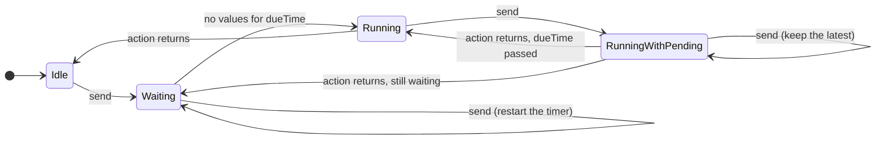

# swift-debounce

[](https://github.com/ivan-magda/swift-debounce/actions/workflows/ci.yml)
[](https://swiftpackageindex.com/ivan-magda/swift-debounce)
[](https://swiftpackageindex.com/ivan-magda/swift-debounce)
[](LICENSE)

Debounce and throttle for Swift Concurrency. You call `send(_:)` from any thread, without `await`, and your async action runs at the right moment, one at a time.

```swift
import Debounce

let search = Debouncer(for: 0.3) { (query: String) in
    await searchService.search(query)
}

search.send("S")
search.send("Sw")
search.send("Swift") // only "Swift" is searched, 0.3 s later
```

## Why

Most debounce code in Swift creates and cancels a `Task` for every value. That works for a search field, but it gets expensive when values arrive often, and it lets two actions run at the same time. This package gives you:

- **A synchronous `send`.** Call it from a delegate method, a KVO observer, a sensor callback, or any thread. No `await` and no `Task` on your side.
- **One task per burst.** A single background task waits for the whole burst instead of a new task per value. `send` costs about 15 ns.
- **Strict order.** Your action never runs concurrently with itself, so a slow request for "Sw" can't overwrite the results for "Swift".
- **Safe cancellation.** `cancel()` and `deinit` drop the pending value. Cancel on the main actor, and a main-actor action that hasn't started yet never starts.
- **Debounce and throttle with the same rules.**
- **A SwiftUI modifier.** `onChange(of:debounce:)` and `onChange(of:throttle:)` in the `DebounceSwiftUI` product, with work that ends when the view goes away.

If you only need to debounce a SwiftUI search field and nothing else, `.task(id: query) { try? await Task.sleep(for: .seconds(0.3)); ... }` may be all you need. Reach for this package when you need a throttle, when two searches must never overlap, when values arrive often, or when the code that produces values isn't async.

## Debounce or throttle?

| You want to... | Use |
|---|---|
| Search once the user stops typing | `Debouncer(for: 0.3)` |
| Run the first tap of a button and ignore quick repeats | `Debouncer(for: 1, edges: .leading)` |
| Update the UI at most a few times a second while values keep coming (scroll position, download progress) | `Throttler(for: 0.25)` |

A **debouncer** waits until values stop arriving. While values keep coming, it doesn't run the action at all. A **throttler** runs the action at a steady pace, at most once per interval, while values keep coming.

Both take `edges`. The leading edge is the first value of a burst, which runs right away. The trailing edge is the last value, which runs when the burst or the interval is over. `Debouncer` uses `.trailing` by default, and `Throttler` uses both.

## Installation

In Xcode, choose **File > Add Package Dependencies** and enter:

```
https://github.com/ivan-magda/swift-debounce
```

In `Package.swift`:

```swift
dependencies: [
    .package(url: "https://github.com/ivan-magda/swift-debounce", from: "0.2.0"),
],
targets: [
    .target(name: "MyApp", dependencies: [
        .product(name: "Debounce", package: "swift-debounce"),
        // For the SwiftUI modifiers. It also brings in Debounce.
        .product(name: "DebounceSwiftUI", package: "swift-debounce"),
    ]),
]
```

Requirements: Swift 6.0 (Xcode 16) or later. iOS 13, macOS 10.15, tvOS 13, watchOS 6, visionOS 1, or Linux. The `Duration`-based initializers need iOS 16, macOS 13, tvOS 16, or watchOS 9; on older systems, pass seconds as a `TimeInterval`. `DebounceSwiftUI` needs iOS 17, macOS 14, tvOS 17, watchOS 10, or visionOS 1.

## Usage

### UIKit

Search as the user types:

```swift
import Debounce
import UIKit

final class SearchViewController: UITableViewController, UISearchBarDelegate {
    private var results: [String] = []

    // A closure in a lazy property doesn't inherit the main actor, so mark it @MainActor.
    private lazy var search = Debouncer(for: 0.3) { @MainActor [weak self] (query: String) in
        await self?.showResults(for: query)
    }

    func searchBar(_ searchBar: UISearchBar, textDidChange searchText: String) {
        search.send(searchText)
    }

    private func showResults(for query: String) async {
        results = await SearchService.shared.search(query)
        tableView.reloadData()
    }
}
```

Protect a button from double taps, and track scrolling at most once a second:

```swift
final class CheckoutViewController: UIViewController, UIScrollViewDelegate {
    private lazy var pay = Debouncer(for: 1, edges: .leading) { @MainActor [weak self] in
        self?.submitPayment()
    }

    private let trackScroll = Throttler(for: 1) { (offset: Double) in
        await Analytics.shared.track("checkout_scroll", value: offset)
    }

    @objc private func payTapped() {
        pay.send()
    }

    func scrollViewDidScroll(_ scrollView: UIScrollView) {
        trackScroll.send(scrollView.contentOffset.y)
    }

    private func submitPayment() { /* ... */ }
}
```

### SwiftUI

Debounce a value right where the view uses it:

```swift
import DebounceSwiftUI

struct SearchView: View {
    @State private var query = ""
    @State private var results: [String] = []

    var body: some View {
        NavigationStack {
            List(results, id: \.self) { Text($0) }
                .searchable(text: $query)
                .onChange(of: query, debounce: .milliseconds(300)) { _, newValue in
                    results = await SearchService.shared.search(newValue)
                }
        }
    }
}
```

`onChange(of:throttle:)` works the same way for values that change continuously, like a slider. The action runs on the main actor and never concurrently with itself. When SwiftUI removes the view, the pending value is dropped and the running action is cancelled. To cancel the pending work yourself, for example when the user presses Return, pass a `PacingHandle`. See [Debouncing value changes in SwiftUI](https://ivan-magda.github.io/swift-debounce/documentation/debounceswiftui/debouncingvaluechanges) for the details.

If the logic belongs to your model, or you support iOS 16 and earlier, keep the debouncer in the model instead. Don't store it in the view: SwiftUI can create a view struct many times, and every copy would get a new debouncer.

```swift
import Debounce
import Observation
import SwiftUI

@MainActor
@Observable
final class SearchModel {
    var query = "" {
        didSet { search.send(query) }
    }
    private(set) var results: [String] = []

    @ObservationIgnored
    private lazy var search = Debouncer(for: 0.3) { @MainActor [weak self] (query: String) in
        guard let self else { return }
        results = await SearchService.shared.search(query)
    }
}

struct SearchView: View {
    @State private var model = SearchModel()

    var body: some View {
        NavigationStack {
            List(model.results, id: \.self) { Text($0) }
                .searchable(text: $model.query)
        }
    }
}
```

### Where the action runs

The action runs on its own actor. A closure created inside a `@MainActor` method (like `viewDidLoad` or an `init` of a main-actor model) inherits the main actor, the same way `Task { }` does. A closure in a stored or `lazy` property doesn't inherit it, so write `{ @MainActor in ... }` there. A closure with no actor runs off the main thread.

The waiting always happens off the main thread.

### Cancelling

```swift
search.cancel() // drops the pending value and cancels the running action
```

You can keep sending values after `cancel()`. Releasing the debouncer has the same effect as `cancel()`, so a closed screen never gets a late callback.

## How it works



This is the trailing debouncer. A few rules hold for both types:

1. The action never runs concurrently with itself. A value that becomes due while the action runs waits for it to return. If more values arrive, only the latest one waits.
2. A throttler starts the action at most once per interval, measured from the start of each action.
3. `cancel()` and `deinit` drop the pending value and cancel the running action. The next action waits until the cancelled one returns.

The full description, with the throttler and the leading edge, is in the [documentation](https://ivan-magda.github.io/swift-debounce/documentation/debounce/).

## Performance

In a burst of 100,000 values, `Debouncer.send` takes 16 ns, against 216 ns for a debouncer that keeps one long-lived task per burst and 798 ns for a new `Task` per value. From 8 threads at once, it takes 60 ns against 393 ns and 1,634 ns. The [benchmarks](Benchmarks/README.md) explain each design decision, from the lock to the clock, with numbers you can reproduce.

## License

MIT. See [LICENSE](LICENSE).
